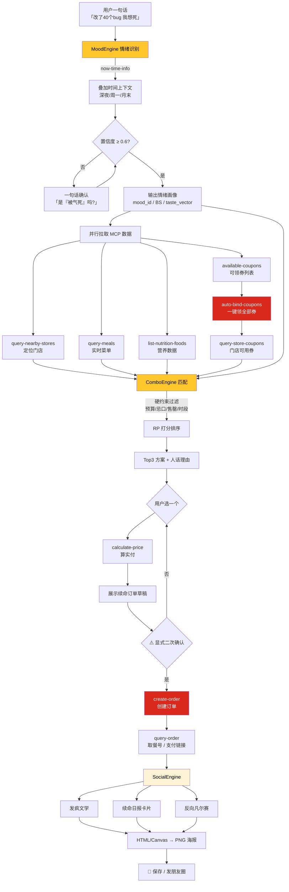

# 🍔 麦麦「打工人精神续命」搭子 — 产品需求文档（PRD）

> 参赛项目 ｜ 2026 麦当劳程序员创意开发大赛（M-CODE）
> 形态 ｜ Agent Skill + 麦当劳官方 MCP（v1.0.9）+ WorkBuddy 驱动
> 文档版本 ｜ v1.0 ｜ 2026-10-10

---

## 0. 一句话定位

> **它不是点餐助手，它是那个会在你说"我不想活了"的时候，回你一句"先吃个麦辣鸡腿堡，我给你算完券只要 23 块"的朋友。**

市面上所有麦当劳 AI 都在解决「怎么点得快」。
只有我们在解决「**你今天到底有多需要这顿饭**」。

---

## 1. 产品定位

### 1.1 用户是谁

| 维度 | 描述 |
|---|---|
| 核心人群 | 18–35 岁城市打工人：实习生、校招生、社畜、乙方、甲方、夜班程序员 |
| 次要人群 | 大学生（期末周 / 失恋 / 月初有钱月末吃土） |
| 典型场景 | 工位、地铁上、加班到 23:47、被老板骂完的那 5 分钟、发薪日中午 |

### 1.2 三层价值模型（这是评审最吃的那层）

```
┌─────────────────────────────────────────┐
│  L3 社交层：可炫耀 / 可吐槽                │
│     发疯文学海报 · 打工人续命日报 · 续命账单 │
├─────────────────────────────────────────┤
│  L2 情绪层：被理解                         │
│     情绪命名 · 失血值 · 共情话术 · 人格陪伴   │
├─────────────────────────────────────────┤
│  L1 功能层：一句话点单（地基）              │
│     情绪 → 套餐 → 最优券 → 算价 → 下单      │
└─────────────────────────────────────────┘
```

**差异点一句话**：传统点餐是「人找券」，我们是「**情绪找套餐 + 券 + 情绪出口**」。

### 1.3 明确不做的事（边界感 = 专业度）

- ❌ 不做心理诊疗 / 医疗建议（重度负面情绪自动引导专业热线）
- ❌ 不承诺"最低价"（价格以 MCP `calculate-price` 实时结果为准）
- ❌ 不采集隐私：不读聊天记录、不做工位级定位、不上传用户情绪画像到任何服务端
- ❌ 不未经确认下单（`create-order` 必须有显式二次确认）

---

## 2. 核心创意机制：「续命值系统」

这是整个项目的**灵魂专利点**，让"情绪推荐"从玄学变成可计算、可解释、可复现。

### 2.1 两个核心指标

| 指标 | 英文 | 范围 | 含义 |
|---|---|---|---|
| **失血值** | Bleed Score（BS） | 0–100 | 用户当前的情绪消耗程度，越惨越高 |
| **续命值** | Revive Points（RP） | 0–100 | 一个"套餐 + 券"组合的治愈能力 |

**匹配目标**：`RP ≥ BS`，且 `实付 ≤ 预算`。

### 2.2 RP 计算公式（可解释，可落地）

```
RP = 40 × taste_fit      # 口味契合度（与情绪口味向量的余弦相似度）
   + 20 × energy_fit      # 热量契合度（加班要高热量，摸鱼要低负担）
   + 20 × func_fit        # 功能契合度（咖啡因提神 / 咀嚼泄愤 / 糖分疗愈）
   + 20 × deal_crit       # 优惠暴击（min(折扣率 / 0.4, 1)，省越多越爽）
```

四个分量都可解释、都能在 UI 上画成一条进度条——**这是"情绪推荐"说服力的来源**。

### 2.3 情绪—口味映射矩阵（产品核心资产）

每个情绪是一个 4 维口味向量 `[咸香, 咀嚼酥脆, 甜, 咖啡因]` + 热量偏好 + 分量偏好。

| 精神状态 | BS | 口味向量 | 热量偏好 | 目标品类 | 续命逻辑（说人话） |
|---|:--:|---|:--:|---|---|
| 🔥 加班到崩溃 | 85 | `[0.9, 0.5, 0.2, 0.9]` | 高 | 安格斯厚牛堡 + 冰美式 | 碳水 + 咖啡因，双管齐下 |
| 😡 被气死 | 90 | `[0.8, 1.0, 0.3, 0]` | 中 | 麦辣鸡翅 ×2 + 麦旋风 | 你需要一个**能咬**的东西 |
| 🐟 摸鱼 | 25 | `[0.4, 0.2, 0.3, 0.1]` | 低 | 麦满分 + 玉米杯 | 吃完不犯困，好继续摸 |
| 💰 发工资 | 15 | `[0.9, 0.7, 0.6, 0.2]` | 高 | 限定品 / 牛堡 / 大份薯条 | 你值得，今天别省 |
| 😵 周一综合征 | 70 | `[0.5, 0.3, 0.7, 1.0]` | 中 | 拿铁 + 薯饼 + 派 | 甜 + 咖啡因强行唤醒 |
| 🎉 周五快乐 | 20 | `[0.8, 0.8, 0.5, 0]` | 高 | 分享盒 / 聚会装 | 快乐要分给别人才算数 |
| 💔 emo / 失恋 | 75 | `[0.3, 0.3, 1.0, 0]` | 中 | 麦旋风 + 派 + 巧克力新地 | Sugar therapy，科学有效 |
| 🏃 赶时间焦虑 | 60 | `[0.7, 0.4, 0.2, 0.5]` | 中 | 早餐组合 / 快取套餐 | 省下的每一秒都是命 |
| 🤡 减肥第 3 天破防 | 65 | `[0.9, 0.9, 0.8, 0]` | 极高 | 随心配全套 + 薯条大份 | 破都破了，破得漂亮点 |
| 😶 被卷到麻木 | 80 | `[0.6, 0.6, 0.6, 0.6]` | 中 | 1+1 随心配（随机） | 让命运替你做决定 |

> 📄 完整 12 种情绪（含"周日晚上的恐惧""月末吃土"）见 `docs/mood-matrix.md`

---

## 3. 功能需求（FR）

### F1｜情绪识别引擎 `MoodEngine`

**输入（多模态）**
- 直述：「我快被气死了」
- **反讽**（亮点）：「今天又是被甲方爸爸宠爱的一天呢 ☺️」 → 识别为"被气死·爆表"
- 场景词：加班 / 周一 / 月末 / 发薪日 / 周日晚
- **时间上下文**：调用 MCP `now-time-info` 拿真实时间 → 23:47 自动排除早餐品、早 8 点自动排除正餐大堡
- 历史：本地记忆的偏好与近期情绪曲线

**输出（结构化）**

```json
{
  "mood_id": "pissed_off",
  "mood_label": "被气死",
  "intensity": 4,
  "intensity_label": "爆表",
  "bleed_score": 90,
  "sarcasm": true,
  "time_context": "late_night",
  "confidence": 0.91,
  "taste_vector": [0.8, 1.0, 0.3, 0.0],
  "need_confirm": true
}
```

**交互铁律**：**先给结论，再确认**。
不追问、不填表。一句话定性 + 一个按钮：

> 「你现在是『**被气死·爆表**』，失血值 90。给你整点能咬的，对吧？」
> `[对，就是这个]` `[没那么严重]` `[换个心情]`

### F2｜套餐与优惠券智能匹配引擎 `ComboEngine`

- **三路输入**：情绪画像 + MCP 实时菜单 + MCP 实时券包
- **硬约束**：预算上限、忌口（不吃辣/过敏）、门店售罄、当前时段可售、可选热量上限
- **输出 Top 3 方案**，每个带**一句人话理由** + **RP 拆解条**

```
方案 A【泄愤流】RP 94 ≥ 失血 90 ✅
  麦辣鸡翅×2 + 麦旋风（原味）
  口味 38/40 · 功能 19/20 · 热量 17/20 · 优惠暴击 20/20
  → "因为你现在需要一个能咬的东西，而这个组合折扣率 41%，气会消一半。"

方案 B【止血流】RP 88 ❌ 略低于失血值
  ...

方案 C【破防流】RP 96 ✅ 但 ¥52 超预算 ¥40
  ...
```

- **省钱可视化**：`原价 ¥68 → 券后 ¥39，省 ¥29 —— 相当于多活 2 小时的底气`

### F3｜一键领券 + 下单 `ActionEngine`

关键：**这是闭环，不是推荐**。

```
available-coupons  →  列出可领券
      ↓
auto-bind-coupons  →  一键全领（官方已封装，一次调用拿满所有券）
      ↓
query-store-coupons → 拿当前门店可用券
      ↓
calculate-price    → 算实付（含配送费）
      ↓
  展示「续命订单」草稿 → ⚠️ 用户显式确认
      ↓
create-order       → 返回支付链接 / 取餐柜二维码
```

- 二次确认卡片必须含：**商品清单 + 门店 + 实付金额 + 所用券**
- `create-order` 前**永不自动执行**；失败要能说人话（"这张券 3 分钟前被抢完了，我给你换了一张"）

### F4｜社交分享 · 发疯文学生成器 `SocialEngine`

> **官方 MCP 没有"生成海报"接口 → 这部分我们本地生成（HTML/Canvas → PNG）**，正好是纯创意加分项，零接口依赖。

三种文体 + 一张竖版卡片：

| 文体 | 示例 |
|---|---|
| **发疯文学** | 「我活着唯一的证据，就是这个麦辣鸡腿堡的订单号 #A073。如果我明天没来上班，请替我把酱挤完。」 |
| **打工人续命日报** | 「【今日续命报告】失血值 90 / 续命值 94 / 实付 ¥39 / 省 ¥29。今日评级：**勉强活着**。」 |
| **反向凡尔赛** | 「月薪 3 千，吃了 39 块的麦当劳。我配吗？我配的。这是我今天唯一一件自己做主的事。」 |

彩蛋：
- 连续打卡 7 天 → 生成「**续命周报**」（含情绪曲线图）
- 月底 → 生成「**续命账单**」（总花费 / 总省钱 / 最惨的一天 / 最爽的一天）
- 触发条件文案：「本月第 12 次『被气死』…… 要不，咱们聊聊？」（附关怀，不越界）

### F5｜记忆与人格 `Companion`

- **记忆**：不吃香菜 / 辣度 / 常去门店 / 预算带 / 过敏源 → 本地 JSON，可导出可删除
- **人格**：麦麦搭子 —— 有点毒舌，但真心疼你
  - ❌ 不说："亲亲，为您推荐以下套餐"
  - ✅ 说："行，我看你今天是真的不行了。这单我给你压到 39，剩下的算我请的。"
- **安全兜底**：检测到重度负面情绪（自伤倾向关键词）→ 停止玩笑，切换为温和话术 + 提供心理援助热线
  ✅ **已实现** `mcd_mood_buddy/safety.py`：三档判定（CRISIS 短路 / CONCERN 附关怀 / NONE），
  在任何 MCP 调用之前执行，告别式表达永不降档。55 项断言见 `tests/test_safety.py`

---

## 4. MCP 接口调用逻辑（**已对齐官方真实 Tool，v1.0.9**）

> ✅ 以下工具名全部来自麦当劳官方仓库 `M-China/mcd-mcp-server`（2026-09-10 更新至 v1.0.9）
> 接入地址：`https://mcp.mcd.cn` ｜ Streamable HTTP ｜ `Authorization: Bearer <TOKEN>`
> 限流：**600 次 / 分钟 / Token** ｜ 错误码：401 Token 无效、429 触发限流

### 4.1 工具选型表（33 个官方 Tool 中，我们用到 15 个）

| # | 官方 Tool | 中文名 | 本项目用途 | 优先级 |
|:--:|---|---|---|:--:|
| 1 | `now-time-info` | 获取当前时间 | **情绪时间上下文**（深夜 / 周一早 / 月末） | **P0** |
| 2 | `query-nearby-stores` | 查询附近可用门店 | 到店取餐场景选门店 | **P0** |
| 3 | `query-meals` | 查询当前可售卖餐品列表 | 拿菜单做匹配（含分类/编码/标签） | **P0** |
| 4 | `query-meal-detail` | 查询餐品详情 | 看套餐组成、可替换选项 | **P0** |
| 5 | `query-store-coupons` | 查询门店可用券 | 选券 | **P0** |
| 6 | `available-coupons` | 麦麦省券列表查询 | 先看有什么可领 | **P0** |
| 7 | `auto-bind-coupons` | 麦麦省一键领券 | **一键领全部券**（神级接口，一次调用拿满） | **P0** |
| 8 | `query-my-coupons` | 我的优惠券 | 用券前核对 | **P0** |
| 9 | `calculate-price` | 商品价格计算 | 算实付 / 优惠金额 / 配送费 | **P0** |
| 10 | `create-order` | 创建订单 | 下单，返回支付链接 / 取餐二维码 | **P0** |
| 11 | `query-order` | 查询订单详情 | 查状态、取餐号 | **P0** |
| 12 | `list-nutrition-foods` | 餐品营养信息列表 | **RP 的"热量契合度"分量** + 热量约束 | **P1** |
| 13 | `query-my-account` | 我的积分查询 | 发工资场景：积分够不够换券 | **P1** |
| 14 | `campaign-calendar` | 活动日历 | 蹭活动（"今天有疯狂星期四"式彩蛋） | **P1** |
| 15 | `order-list` | 查询历史订单 | 月底生成「续命账单」 | **P2** |
| 16 | `delivery-query-addresses` | 获取配送地址 | 麦乐送场景 | **P1** |
| 17 | `delivery-query-stores` | 查询可配送门店 | 麦乐送场景 | **P1** |
| 18 | `cancel-order` | 取消订单 | 反悔保护 | **P2** |
| 19 | `mall-points-products` / `mall-create-order` | 积分商城 | 发工资场景：积分兑券叠加 | **P2** |
| 20 | `draw-lottery` / `query-lottery-info` | 积分抽奖 | **彩蛋**：emo 时"抽个奖转运" | **P2** |

**暂不使用**：`query-party-*` / `party-order-create`（主题活动派对，MVP 不碰）、`query-meal-assistance`（企业团餐）、`delivery-create-address`（地址写操作，风险高）。

### 4.2 为什么这几个接口是"必杀"组合

| 组合 | 为什么评委眼前一亮 |
|---|---|
| `now-time-info` + 情绪 | **用官方时间接口驱动情绪上下文**，23:47 自动不推早餐 —— 细节见真章 |
| `auto-bind-coupons` + `calculate-price` | **一键领全部券 → 实时算实付**，闭环省钱，不是"推荐"是"真给钱" |
| `list-nutrition-foods` + 情绪 | **用官方营养数据算"治愈力"**，把玄学变成数学 |
| `draw-lottery` | emo 场景抽个奖转运 —— **情绪化彩蛋，纯创意** |

### 4.3 降级容错（**必须实现，否则现场演示必翻车**）

| 风险 | 兜底方案 |
|---|---|
| 401 Token 失效 | 切 `--mock` 模式，用 `mcp-server/mock_data/*.json` 演示全流程 |
| 429 限流 | 本地缓存菜单（TTL 10 min）+ 指数退避重试 |
| 某券被抢完 | `calculate-price` 失败 → 自动换次优券重算，最多 3 次 |
| 门店售罄 | `query-meals` 已带实时可售标记 → 直接过滤 |
| 接口字段变更 | `mcp_client.py` 统一适配层 + 字段默认值，不让上层崩 |

> 🎤 **答辩话术**："我们假设 MCP 会挂。所以整套流程有 `--mock` 模式，评委老师现在断网也能看完整 demo。"

---

## 5. 调用流程图

### 5.1 主链路（Mermaid，直接贴 README 可渲染）



### 5.2 时序要点

- **并行而非串行**：菜单 / 门店 / 券 / 营养四条线并行拉取，把首屏压到 3 秒内
- **领券在计算之前**：先 `auto-bind-coupons` 拿满券，再 `calculate-price`，才能拿到真实最低价
- **算价在下单之前**：绝不自己算钱，一切以 `calculate-price` 返回为准
- **确认在 create-order 之前**：硬闸门，不可跳过

---

## 6. GitHub 仓库目录结构（大赛标准）

```
mcd-mood-buddy/
│
├── README.md                          # ⭐ 项目主文档（大赛必看）
├── LICENSE                            # MIT（注意：不含麦当劳商标授权）
├── NOTICE.md                          # ⭐ 参赛声明 + 商标/数据使用声明
├── CONTRIBUTING.md
├── CHANGELOG.md
├── .gitignore                         # 必须忽略 token 文件！
├── .env.example                       # MCD_MCP_TOKEN=your_token_here
│
├── docs/                              # 📚 文档区（评委主要看这里）
│   ├── 01-PRD.md                      # 本需求文档
│   ├── 03-mood-matrix.md              # 情绪—口味映射矩阵（核心资产）
│   ├── 04-flow-diagram.md             # 调用流程图（Mermaid + PNG）
│   ├── 05-user-stories.md             # 完整用户故事集
│   ├── 06-competition-declaration.md  # ⭐ 参赛声明（原创性 / 授权 / 联系方式）
│   ├── 07-demo-script.md              # 3 分钟演示脚本 + 答辩 Q&A 预案
│   └── assets/
│       ├── demo.gif                   # ⭐ 3 秒动图，README 首屏
│       ├── poster-sample-1.png        # 发疯文学海报样张
│       ├── poster-sample-2.png
│       └── architecture.png
│
├── skill/                             # 🤖 WorkBuddy Skill 本体
│   ├── SKILL.md                       # ⭐ Skill 主入口（核心交付物）
│   ├── references/
│   │   ├── mood-matrix.md             # 情绪矩阵（SKILL.md 按需加载）
│   │   ├── mcp-tools.md               # 官方 33 工具速查 + 入参样例
│   │   ├── copywriting-bank.md        # 发疯文学语料库（按情绪分类）
│   │   └── safety-rules.md            # 情绪安全兜底规则
│   ├── scripts/
│   │   ├── mcp_client.py              # MCP 统一封装（重试/降级/mock）
│   │   ├── mood_engine.py             # 情绪识别
│   │   ├── combo_engine.py            # RP 打分 + 匹配
│   │   ├── social_engine.py           # 发疯文学生成
│   │   ├── poster.py                  # HTML → PNG 海报
│   │   └── main.py                    # CLI 入口（支持 --dry-run/--mock）
│   └── assets/
│       ├── poster_template.html       # 竖版海报模板
│       └── mood-icons/                # 12 种情绪图标
│
├── mcp-server/                        # 🧪 本地 Mock（演示保命用）
│   ├── server.py                      # 极简 MCP Mock Server
│   └── mock_data/
│       ├── menu.json
│       ├── coupons.json
│       ├── stores.json
│       └── nutrition.json
│
├── src/                               # 可选：服务化版本（Web Demo）
│   ├── api/
│   └── web/
│
├── tests/
│   ├── test_mood_engine.py
│   ├── test_combo_engine.py
│   └── test_mcp_client.py             # mock 模式单测，无 Token 也能跑
│
├── demo/
│   ├── cli-demo.sh
│   └── sample-session.log             # 真实一问一答实录
│
└── .github/
    ├── ISSUE_TEMPLATE/
    │   ├── bug_report.yml
    │   └── new_mood.yml               # 「新增一种情绪」模板（社区玩法）
    └── workflows/
        └── ci.yml                     # lint + mock 模式单测
```

### 目录设计思路（答辩可讲）

1. **`skill/` 放最前** —— 表明"这是个真 Skill，不是 PPT"
2. **`mcp-server/` _mock_ —— 表明"我们考虑过断网"
3. **`docs/` 六件套** —— 大赛要求的三件套（项目介绍 / 参赛声明 / MCP 接入说明）全部有独立文件，评委好找
4. **`.env.example` + `.gitignore`** —— 表明"我们懂安全，Token 不会泄露"

---

## 7. README 大纲（可直接照抄成文）

```markdown
# 🍔 麦麦「打工人精神续命」搭子

[]()
[]()
[](...)

> **你不是一个人在饿，你是一个人在崩溃。**
> 一个听得懂你今天有多惨，并给你算好券的麦当劳 AI 搭子。

[3 秒 Demo GIF]

---

## 💡 为什么做这个

所有麦当劳 AI 都在回答"吃什么"。
但打工人真正的问题是——**"我今天这么惨，我该吃什么才对得起自己？"**

我们把它变成了一道可计算的题：
**失血值（你有多惨）× 续命值（这顿饭有多治愈）→ 最优券组合 → 一键下单 → 发疯文学海报**

---

## ✨ 五个亮点

| # | 亮点 | 说明 |
|:--:|---|---|
| 1 | 🩸 **续命值系统** | 把"情绪推荐"从玄学变成数学，RP = 口味×40 + 热量×20 + 功能×20 + 优惠暴击×20 |
| 2 | 🗺️ **情绪—口味矩阵** | 12 种打工人精神状态 × 4 维口味向量，「被气死」→ 要能咬的 |
| 3 | 🎫 **领券闭环** | `auto-bind-coupons` 一键领满 → `calculate-price` 算真价，不是"推荐"是真省钱 |
| 4 | 🤯 **发疯文学生成器** | 三种文体 + 竖版海报，点完单直接发朋友圈 |
| 5 | 🛡️ **断网也能跑** | 内置 Mock MCP Server，评委现场断网照样演示 |

---

## 🚀 30 秒上手

1. 到 [open.mcd.cn/mcp](https://open.mcd.cn/mcp) 用手机号申请 MCP Token
2. `export MCD_MCP_TOKEN="你的Token"`
3. `python skill/scripts/main.py "我今天快被气死了" --dry-run`
4. 去掉 `--dry-run` 才真下单（默认永不自动下单）

---

## 🎬 三个真实 User Story

（见第 8 节，配对话实录）

---

## 🔌 MCP 接入说明

- 地址 `https://mcp.mcd.cn` ｜ Streamable HTTP ｜ Bearer Token
- 用到 15 个官方 Tool（完整清单见 `MCP_INTEGRATION.md`）
- [流程图](docs/04-flow-diagram.md) ｜ 限流 600 次/分钟 ｜ 已实现指数退避 + 本地缓存

---

## 📁 目录结构 ｜ 🗺️ 路线图 ｜ 🤝 贡献 ｜ ⚖️ 参赛声明 ｜ 👥 团队
```

---

## 8. 用户交互示例（User Story）

### 🎬 US-1｜深夜加班（走通完整闭环）

```
👤 用户：「还有 40 个 bug 要改，我想死」

🤖 搭子：
  [调用 now-time-info] → 23:47，深夜
  ────────────────────────────────
  识别：加班到崩溃·重度  失血值 BS 85
  时间上下文：深夜 → 已过滤早餐/已打烊品

  [并行] query-nearby-stores → 科技园店（营业至次日 2:00）
         query-meals → 实时菜单（已过滤售罄）
         available-coupons → 找到 6 张可领券
  [auto-bind-coupons] → ✅ 已领 6 张（含夜宵套餐券）
  [query-store-coupons] → 可用 4 张
  [list-nutrition-foods] → 载入热量数据

  ── 为你匹配到 3 个方案 ──

  🥇【硬撑流】RP 92 ✅
     安格斯厚牛堡 + 大杯冰美式 + 薯条（大）
     原价 ¥71 → 券后 ¥42（省 ¥29）
     口味 36/40 · 热量 20/20 · 功能 18/20 · 优惠暴击 18/20
     → 碳水 + 咖啡因双管齐下，够你撑到改完那 40 个。

  🥈【省命流】RP 85 ⚠️ 刚好卡线
     1+1 随心配（牛堡+冰美）+ 麦香鱼
     原价 ¥48 → 券后 ¥29（省 ¥19）
     → 便宜 13 块，但续命值刚好卡线，看你敢不敢赌。

  🥉【破防流】RP 98 ✅ 但 ¥68 超预算
     → 好是好，钱包不同意。

👤 用户：「第一个」

🤖 搭子：
  [calculate-price] → 实付 ¥42.00（含配送费 ¥0，到店取）
  ────────────────────────────────
  ⚠️ 最后确认
  门店：麦当劳科技园店（到店取餐）
  商品：安格斯厚牛堡 ×1 / 大杯冰美式 ×1 / 大薯条 ×1
  用券：夜宵套餐券 + 满 40 减 8
  实付：¥42.00（原价 ¥71，省 ¥29）
  [确认下单] [再想想]

👤 用户：「确认」

🤖 搭子：
  [create-order] → ✅ 订单号 #A073
  [query-order]  → 取餐柜二维码已生成

  ── 🎴 给你做了张卡片 ──
  「23:47，我和我的第 40 个 bug，还有一个安格斯厚牛堡。
    今日续命报告：失血 85 / 续命 92 / 实付 ¥42 / 省 ¥29
    评级：勉强活着。」
  [保存图片] [复制文案]
```

**跑通的接口**：`now-time-info` `query-nearby-stores` `query-meals` `available-coupons` `auto-bind-coupons` `query-store-coupons` `list-nutrition-foods` `calculate-price` `create-order` `query-order` —— **10 个**

---

### 🎬 US-2｜被甲方气死（展示反讽识别 + 发疯文学）

```
👤 用户：「甲方说要'五彩斑斓的黑'，我笑了 ☺️」

🤖 搭子：
  检测到反讽 ☺️ → 真实情绪：被气死·爆表  失血值 BS 90
  ────────────────────────────────
  匹配的不是"笑"，是"咬"。

  [auto-bind-coupons] → 已领 6 张
  [query-meals] → 筛选"酥脆/辣"标签

  🥇【泄愤流】RP 94 ✅
     麦辣鸡翅 ×2（10 块）+ 麦旋风（原味）+ 可乐（中）
     原价 ¥58 → 券后 ¥34（省 ¥24，折扣率 41%）
     功能分 19/20 —— 咀嚼泄愤指数拉满
     → 你需要一个能咬的东西。这个组合折扣 41%，气至少消一半。

👤 用户：「就它，再给我整段文案」

🤖 搭子：
  ✅ 已下单 ¥34

  ── 发疯文学 · 已生成 ──
  「甲方要五彩斑斓的黑。
    我给了。
    黑白的是我的简历，彩色的是我骂人的词汇量。
    吃完这 10 块麦辣鸡翅，明天继续改第 11 版。
    —— 订单号 #B291，这是我今天唯一自己做的决定。」

  [保存海报] [复制文案] [换个更疯的]
```

**亮点**：反讽识别 + `draw-lottery` 彩蛋（可选加一句"要不抽个奖转运？"）

---

### 🎬 US-3｜发工资（展示积分 + 反向凡尔赛）

```
👤 用户：「发工资了！！！」

🤖 搭子：
  [now-time-info] → 10 号 12:30（发薪日，实锤）
  [query-my-account] → 你有 2,340 积分（其中 800 分 7 天后过期！）
  ────────────────────────────────
  识别：发工资·犒赏  失血值 BS 15（你今天不需要续命，你值得庆祝）

  ⚠️ 提醒：800 积分 7 天后过期，不用就亏了

  🥇【值得流】RP 96 ✅
     限定品「麻辣板烧鸡腿堡」+ 大份薯条 + 麦旋风 + 冰拿铁
     原价 ¥86 → 券后 ¥58
     🎁 再叠加：800 积分兑换「免费麦旋风券」→ 实付 ¥46
     → 积分不用白不用，这单我给你压到 46，剩下的算你请自己的。

👤 用户：「冲！」

🤖 搭子：
  [mall-create-order] → 800 积分 → 麦旋风券 ✅
  [calculate-price] → 实付 ¥46.00
  [create-order] → ✅ #C118

  ── 反向凡尔赛 · 已生成 ──
  「月薪 3 千，吃了 46 块的麦当劳。
    我配吗？我配的。
    这是我这个月唯一一件自己说了算的事。」
```

**跑通接口额外用到**：`query-my-account` `mall-points-products` `mall-create-order`

---

### 🎬 US-4｜摸鱼（展示"反向智能"——克制也是智能）

```
👤 用户：「下午三点，无事发生」

🤖 搭子：
  识别：摸鱼·轻度  失血值 BS 25
  ────────────────────────────────
  这次我不给你推大堡。
  你现在吃太饱，下午会犯困 —— 犯困就会被发现。

  🥇【续命流】RP 40 ✅（够用就行）
     玉米杯 + 麦满分（小）+ 无糖可乐
     原价 ¥26 → 券后 ¥18
     热量分 20/20（低负担，吃完继续摸）
     → 别吃太饱。活着才能摸到下班。

  💡 摸鱼小贴士：这单 ¥18，比你楼下那杯 ¥32 的咖啡划算，
     而且不会被同事看见你拿了外卖。
```

> **给评委看的**：这 4 个 Story 覆盖了「重度负面 / 反讽 / 正向犒赏 / 轻度日常」四种情绪极性，
> 证明系统不是"只会推大堡"，而是**真懂分寸**。

---

## 9. 大赛评审对齐（为什么这个项目能拿分）

| 评审维度 | 我们的得分点 |
|---|---|
| **创意性** | 续命值系统 + 情绪—口味矩阵 + 发疯文学；「反讽识别」「摸鱼不推大堡」体现洞察深度 |
| **技术性** | 15 个官方 MCP Tool 编排；并行拉取 + 指数退避 + 本地缓存 + Mock 降级 |
| **实用性** | 真领券、真算价、真下单、真省钱（每个 Story 都有明确省钱金额） |
| **完成度** | CLI 可跑通，Skill 可安装，Mock 模式无 Token 也能演示 |
| **传播性** | 发疯文学海报天然适合朋友圈传播 → 二次传播 = 大赛想要的声量 |
| **文档质量** | docs 六件套齐全，README 有 Demo GIF，MCP 接入说明独立成文 |

---

## 10. MVP 范围与里程碑

| 阶段 | 范围 | 产出 |
|---|---|---|
| **P0（必做，2 天）** | 情绪识别（直述 + 时间上下文）+ 菜单/券匹配 + 领券 + 算价 + 下单确认 + 发疯文学文本 | 完整闭环 CLI |
| **P1（加分，2 天）** | 反讽识别 + 12 情绪全矩阵 + 营养数据接入 + 海报 PNG 生成 + 积分/活动日历彩蛋 | 海报 + 彩蛋 |
| **P2（锦上添花）** | 记忆模块 + 续命周报/账单 + 抽奖彩蛋 + Web Demo | 周报 + Demo 站 |

### 建议排期（假设 7 天）

```
D1  申请 Token + 跑通 MCP Hello World + 目录骨架
D2  mcp_client.py（含 mock）+ query-meals / coupons 跑通
D3  MoodEngine + ComboEngine（RP 公式落地）
D4  ActionEngine（领券→算价→下单，含二次确认闸门）
D5  SocialEngine + 海报模板
D6  SKILL.md + README + docs 六件套 + 录 Demo GIF
D7  演练 3 分钟答辩 + Q&A 预案 + 提交
```

---

## 11. 风险与合规

| 项 | 处理 |
|---|---|
| 🏷️ **商标** | `NOTICE.md` 明确声明：非官方项目，不构成麦当劳商标授权，Logo 使用遵循官方规范 |
| 🔑 **Token 安全** | 仅存环境变量 / `~/.config/mcd/mcp_token`（`umask 077`），`.gitignore` 强制忽略，README 显著提示 |
| 🚫 **不下单承诺** | `create-order` 必须显式确认；`--dry-run` 为默认安全档 |
| 🧠 **情绪不是诊断** | 重度负面情绪（自伤倾向）→ 停止玩笑话术 + 提供 24h 心理援助热线（如 400-161-9995） |
| 📊 **数据最小化** | 情绪画像仅存本地 JSON，可一键导出/删除，不上传任何服务器 |
| ⚖️ **原创声明** | `docs/06-competition-declaration.md` 声明原创 + MCP 数据来源 + 第三方依赖清单 |

---

## 12. 3 分钟演示脚本（给答辩用）

| 时间 | 动作 | 台词 |
|:--:|---|---|
| 0:00–0:20 | 抛痛点 | "所有麦当劳 AI 都在回答吃什么。但打工人真正的问题是——我今天这么惨，该吃什么才对得起自己？" |
| 0:20–1:00 | **US-2 被气死**（最炸） | 现场输入「甲方要五彩斑斓的黑，我笑了 ☺️」→ 反讽识别 → 泄愤流 → 发疯文学海报 |
| 1:00–1:40 | **US-1 深夜加班**（最全） | 展示 10 个 MCP 接口全链路 + 省 ¥29 + 二次确认闸门 |
| 1:40–2:10 | 技术点 | 亮 RP 公式 + 并行拉取 + Mock 降级（**现场断网演示**） |
| 2:10–2:40 | **US-4 摸鱼**（最见功力） | "我们不只会推大堡——摸鱼的时候，克制才是智能" |
| 2:40–3:00 | 收尾 | 发疯文学海报墙 + "每个打工人都值得被好好喂一顿" |

### Q&A 预案

- **Q：情绪推荐是不是玄学？** → A：不是。RP 公式四分量可拆解，营养数据来自官方 `list-nutrition-foods`，每一项都能在 UI 上画成进度条。
- **Q：MCP 挂了怎么办？** → A：我们有 Mock Server，现场断网也能演示全流程（**当场演示**）。
- **Q：会不会误下单？** → A：`create-order` 前有两道闸门：显式确认卡片 + `--dry-run` 默认档。
- **Q：商业价值？** → A：情绪化推荐提升客单（发工资场景推限定品）+ 海报带来自然传播 + 券核销率提升。

---

## 附录 A｜官方 MCP Tool 全清单（v1.0.9，33 个）

<details>
<summary>点开查看</summary>

**点餐类**：`list-nutrition-foods` `query-nearby-stores` `query-meals` `query-meal-detail` `query-store-coupons` `calculate-price` `create-order` `cancel-order` `query-order` `order-list` `delivery-query-addresses` `delivery-create-address` `delivery-query-stores` `query-meal-assistance`

**优惠券类**：`available-coupons` `auto-bind-coupons` `query-my-coupons`

**积分商城类**：`query-my-account` `mall-points-products` `mall-product-detail` `mall-create-order` `mall-order-list` `mall-order-detail`

**抽奖类**：`query-lottery-info` `draw-lottery` `query-my-prizes`

**活动类**：`campaign-calendar` `now-time-info`

**派对类**：`query-party-city` `query-party-store` `query-partystore-date` `query-partystore-session` `party-order-create`

</details>

## 附录 B｜参考来源

- 麦当劳 MCP 官方仓库：<https://github.com/M-China/mcd-mcp-server>
- MCP 开放平台：<https://open.mcd.cn/mcp>
- 接入地址：`https://mcp.mcd.cn`（Streamable HTTP，Bearer Token，600 次/分钟）
- WorkBuddy Connector 文档：<https://www.workbuddy.cn/docs/workbuddy/From-Beginner-to-Expert-Guide/Function-Description/Connector>

---

**© 2026 · 本项目为参赛作品，非麦当劳官方产品。价格与库存以麦当劳 MCP 实时返回为准。**
